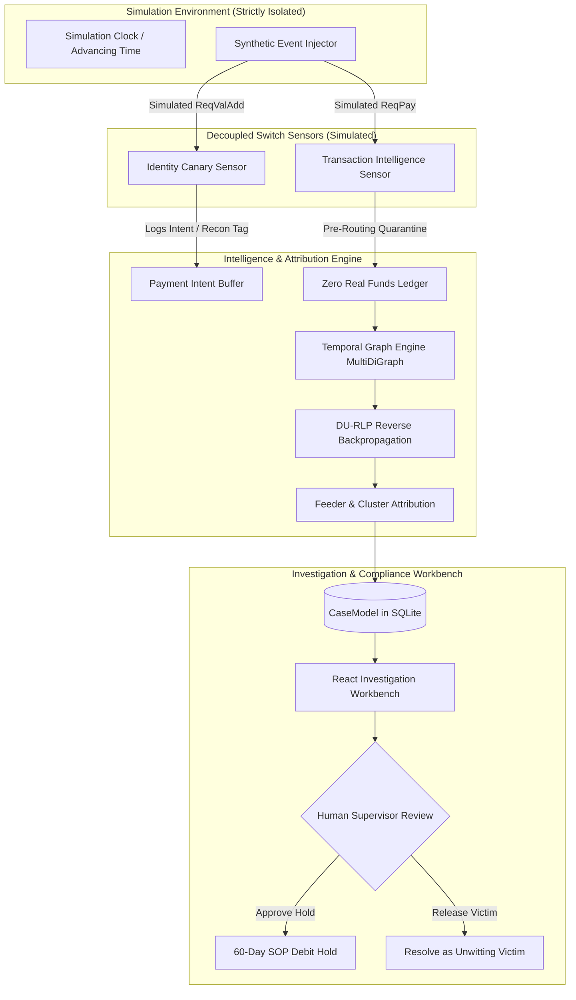

# GHOST-VPA — FINAL STRATEGIC VERIFICATION & COMPETITIVE CLAIM CORRECTION
**Rigorous Regulatory Reconciliation, Evidentiary Claim De-escalation & Defensible Positioning**

**Author:** Independent Principal Banking Technology Strategist, Financial Crime Intelligence Researcher & Sceptical Hackathon Judge  
**Evaluator Platform:** Gemini 3.8 Flash via Antigravity CLI  
**Competition:** St Aloysius Foundation / AIMIT FinTech Innovation Hackathon 2026 × RBIH — Track 1  
**Date:** 2026-11-17  
**Status:** READ-ONLY INVESTIGATION & FORMAL STRATEGIC STAGE 3 RE-EVALUATION  
**Deliverable Path:** `artifacts/step5/GEMINI_FINAL_STRATEGIC_CORRECTION.md`

---

## 1. Executive Summary & Revised Strategic Verdict

### 1.1 The Re-Evaluation Imperative
Following a strict evidentiary review of previous audit deliverables (`GEMINI_COMPETITIVE_DIFFERENTIATION_AND_INCREMENTAL_VALUE.md`), several core assumptions and quantitative performance projections required immediate re-evaluation against:
1. **NPCI Operating Circular `NPCI/UPI/OC/215A/2025-26` (dated 21 May 2025):** Strict regulatory restrictions on the usage of the `Validate Address` (`ValAdd`) API and penny-drop verification.
2. **Reserve Bank of India Press Release 2024-2025/1852 (PRID 59465, dated 4 January 2025):** Official winner descriptions for HaRBInger 2024 (*Satark* by Epifi Technologies and *Tager AI* by NapID Cybersec).
3. **Reserve Bank of India Annual Report 2024–25 / 2025–26 (Publication Id 1466):** Strategic roadmap for MuleHunter.ai™ and the Digital Payment Intelligence Platform (DPIP).

### 1.2 Revised Strategic Verdict: CONDITIONAL GO (Reframed & De-Escalated)
The project remains a **CONDITIONAL GO**, but its central thesis, performance claims, and competitive positioning must be substantially de-escalated and reframed.

```
                    ┌────────────────────────────────────────────────────────┐
                    │               REFRAMED VALUE PROPOSITION               │
                    └────────────────────────────────────────────────────────┘
                                                 │
         ┌───────────────────────────────────────┴───────────────────────────────────────┐
         ▼                                                                               ▼
┌─────────────────────────────────┐                                             ┌─────────────────────────────────┐
│     WHAT MUST BE WITHDRAWN      │                                             │   WHAT LEGITIMATELY SURVIVES    │
├─────────────────────────────────┤                                             ├─────────────────────────────────┤
│ • "P=1.0 Criminal Ground Truth" │                                             │ • "P=1.0 Verified Interaction   │
│   (Conflates probe with guilt). │                                             │   Signal" (Endpoint touched).   │
│ • Standalone Bot Reconnaissance │                                             │ • Bank-side internal suspense GL│
│   via ReqValAdd (Banned by OC215A).                                           │   canary mapping (Zero Fake KYC)│
│ • Projected 84%/92% attribution │                                             │ • Single-probe +0.4465 DU-RLP   │
│   (Unmeasured projections).     │                                             │   separation on Scenario B.     │
│ • Claims that HaRBInger winners │                                             │ • Tactical in-switch sensor     │
│   cannot do graph or real-time. │                                             │   augmenting central platforms. │
└─────────────────────────────────┘                                             └─────────────────────────────────┘
```

The surviving, defensible core proposition is:
> **"A bank-side active intelligence acquisition and temporal graph investigation layer that provides additional verified interaction signals to existing mule-detection platforms."**

---

## 2. Critical NPCI Regulatory Reconciliation: Circular OC 215A/2025-26

On 21 May 2025, the National Payments Corporation of India (NPCI) issued Operating Circular **`NPCI/UPI/OC/215A/2025-26`** titled *"Guidelines on usage of UPI APIs"*. This circular establishes strict boundaries that directly invalidate key assumptions of the original Ghost-VPA reconnaissance model.

```
┌────────────────────────────────────────────────────────────────────────┐
│             NPCI OC 215A/2025-26 REGULATORY CONSTRAINTS                │
├────────────────────────────────────────────────────────────────────────┤
│ 1. Validate Address (ValAdd) Customer Intent Mandate:                  │
│    • ValAdd must ONLY be invoked when a customer explicitly intends   │
│      to initiate a payment transaction within a licensed PSP app.      │
│    • Standalone or decoupled use of ValAdd is strictly PROHIBITED.     │
│                                                                        │
│ 2. Prohibition of Automated Reconnaissance & Enumeration:             │
│    • Bulk, automated, or programmatic batch calling of ValAdd          │
│      without user payment initiation requires specific NPCI approval.  │
│                                                                        │
│ 3. Penny-Drop Verification Restrictions:                               │
│    • Penny-drop transactions are restricted strictly to entities where │
│      it is an explicit regulatory mandate (e.g. SEBI/PFRDA/IRDAI KYC). │
│    • Must use dedicated Merchant Category Code MCC 7413.               │
│    • Explicit customer consent is mandatory.                           │
└────────────────────────────────────────────────────────────────────────┘
```

### 2.1 Impact on the Ghost-VPA "Bot Reconnaissance" Proposition
The previous deliverable assumed that Ghost-VPA could act as a wide-net honeypot capturing automated botnet dictionary enumeration via high-frequency `ReqValAdd` lookups. **Under OC 215A, this assumption is invalid:**
1. **PSP-Level Throttling Blocks Enumeration Before the Switch:** Because standalone `ValAdd` is banned and PSP applications must enforce rate-limiting, CAPTCHA, and user session binding, automated dictionary enumeration scripts targeting phone numbers or VPAs are throttled at the remitter PSP. They will **rarely reach the destination bank switch** as raw, unauthenticated bot crawls.
2. **The Bank Cannot Query External Accounts via ValAdd:** Ghost-VPA cannot propose that the bank itself runs automated `ValAdd` checks against external suspect accounts to test connectivity, as that constitutes unauthorized standalone API use.
3. **Adversary Penny-Drops are Non-Standard:** Syndicates testing mule accounts do not operate with regulatory mandates or MCC 7413. When a fraudster tests an account, they execute a **standard P2P transfer of ₹1–10 (MCC 0000 / generic P2P)**. Calling this a "regulatory penny-drop" conflates institutional verification with illicit pre-testing.

### 2.2 The Viable, Compliant Sensor Reframing
Does OC 215A completely eliminate the utility of `ReqValAdd` for Ghost-VPA? **No, but its role must be precisely reframed:**
- **What is NOT Viable:** Claiming to detect automated botnet enumeration crawls across unlisted decoy handles.
- **What IS Viable:** Capturing the **in-flight address resolution event** when a fraudster manually or semi-automatically types a canary handle into a genuine UPI app (e.g., PhonePe, Google Pay) to stage a transfer.
- When an adversary stages a payment to `canary.alert@bank`, the remitter app generates `ReqValAdd` to fetch the payee name. The destination bank switch receives this message. Ghost-VPA observes this as a **Payment Intent Precursor**, logging the remitter PSP, timestamp, and target handle *before* the financial debit occurs.

---

## 3. Correct Competitor Characterisation: HaRBInger 2024 Winners

In previous drafts, competitor solutions were categorized as "strictly passive" (Satark) or "exclusively post-event downstream tracking" (Tager AI). A rigorous review of the RBI's official winner announcement (PR 2024-2025/1852, PRID 59465, dated 4 January 2025) requires correcting these characterizations.

We apply a strict four-tier classification:
- **Confirmed:** Proven through primary regulatory or technical documentation.
- **Publicly Described:** Explicitly stated in official press releases or verified product documentation.
- **Not Established:** Capabilities not evidenced in public material, but which cannot be assumed absent.
- **Unknown:** Proprietary implementation details that remain confidential.

```
┌────────────────────────────────────────────────────────────────────────┐
│                   CORRECTED COMPETITOR CAPABILITY AUDIT                │
├────────────────────────────────────────────────────────────────────────┤
│ SATARK (Epifi Technologies Pvt. Ltd.):                                 │
│ • Status: Joint Winner, HaRBInger 2024 (Theme 1, Problem Statement 1). │
│ • Public Description (RBI): Real-time identification of mule accounts  │
│   using financial, non-financial, profile, device & external data.     │
│ • Classification: Confirmed Real-Time Account Profiling.               │
│ • Correction: Do not call "strictly passive". While its inputs are     │
│   telemetry-derived, its decisioning is real-time in-line.             │
│                                                                        │
│ TAGER AI (NapID Cybersec Pvt. Ltd.):                                   │
│ • Status: Joint Winner, HaRBInger 2024 (Theme 1, Problem Statement 1). │
│ • Public Description (RBI): Real-time interoperable AI/ML platform     │
│   using Loop Tagging to track transactions across multiple banks.      │
│ • Classification: Confirmed Interoperable Cross-Bank Transaction Tracing│
│ • Correction: Do not call "exclusively post-event". Loop tagging can   │
│   operate in-flight on live transaction requests as they clear.        │
└────────────────────────────────────────────────────────────────────────┘
```

### 3.1 Precise Technical Assessment of HaRBInger Winners

| Architectural Dimension | Satark (Epifi Technologies) | Tager AI (NapID Cybersec) | Ghost-VPA |
|---|---|---|---|
| **Primary Telemetry Source** | **Publicly Described:** Omnichannel digital footprint (financial, non-financial, profile, device, external). | **Publicly Described:** Transaction metadata across payment rails tagged with interoperable identifiers. | **Confirmed (Prototype):** Simulated payment rail events and bank-owned canary GL endpoints. |
| **Real-Time Detection** | **Confirmed (RBI PR 59465):** Operates in real time to flag suspicious accounts. | **Confirmed (RBI PR 59465):** Operates in real time to track suspicious flows. | **Confirmed (Prototype):** Sub-50ms triage response on simulated events. |
| **Cross-Bank Scope** | **Not Established:** Public evidence focuses on account profiling; multi-bank switch tracing unknown. | **Confirmed (RBI PR 59465):** Tracks transactions and detects suspicious activity across multiple banks. | **Partially Supported:** Simulated multibank graph; live production depends on STIX sharing. |
| **Active Decoy Endpoints** | **Not Established** | **Not Established** | **Confirmed (Prototype):** Bank-controlled canary handles on internal GL accounts. |
| **Upstream Reverse Backprop**| **Not Established** | **Unknown:** Focus is on tracking fund movement and loop detection; reverse feeder attribution unverified. | **Confirmed (Prototype):** DU-RLP algorithmic backpropagation against money direction. |

**Analytical Rule:** The absence of public documentation for canary handles in Satark or Tager AI does **not** prove they could never build one. It proves that **their awarded core innovation lies elsewhere** (Satark in comprehensive multi-modal footprinting; Tager AI in cross-bank loop tagging). Ghost-VPA's differentiation must be argued on the **merits of the payment decoy mechanism itself**, not on assumed competitor incompetence.

---

## 4. Reassessing MuleHunter.ai & DPIP Complementarity

Review of the **Reserve Bank of India Annual Report 2024–25 / 2025–26 (Publication Id 1466)** indicates that MuleHunter.ai™ (developed by RBIH) and the Digital Payment Intelligence Platform (DPIP) represent a high-priority, central-bank-backed infrastructure push.

```
                    MULEHUNTER.AI & GHOST-VPA FUNCTIONAL BOUNDARY
                    
┌────────────────────────────────────────────────────────────────────────┐
│ CENTRAL INTELLIGENCE LAYER (MuleHunter.ai / DPIP):                     │
│ • Multi-Bank Aggregation: Ingests cross-bank transaction feeds.        │
│ • Supervised ML Ensembles: Maps macro fraud patterns across 30+ PSBs.  │
│ • Shared Negative Registry: Phase 1 DPIP consortium database.          │
│ • Central Collaboration: Ingests I4C Suspect Registry feeds.           │
└──────────────────────────────────┬─────────────────────────────────────┘
                                   │ LACKS DIRECT BANK-INTERNAL ASSETS
                                   ▼
┌────────────────────────────────────────────────────────────────────────┐
│ BANK-SIDE TACTICAL SENSOR LAYER (Ghost-VPA Domain):                    │
│ • Bank-Owned Balance Sheet Assets: Manages internal GL canary handles. │
│ • Local In-Switch Pre-Routing Hook: Sub-15ms check at bank switch.     │
│ • Pre-Cashout Fund Quarantine: Credits GL_SUSPECT_CANARY_ESCROW.       │
│ • Sovereign Legal Intervention: Enforces statutory Annex III holds.    │
└────────────────────────────────────────────────────────────────────────┘
```

### 4.1 De-Escalating the Institutional Moat Argument
Previous audit drafts argued that *"RBIH's institutional status as a non-bank prevents it from ever implementing canary sensors."* **This argument is flawed and must be withdrawn:**
- While RBIH itself is not a commercial bank, it operates in direct collaborative alignment with scheduled commercial banks (e.g., Canara Bank, State Bank of India). If RBIH determined that canary VPAs were effective, it could readily issue guidelines or software specifications for member banks to deploy them.
- Therefore, Ghost-VPA's differentiation **cannot rest on institutional exclusivity**.

### 4.2 The Legitimate Engineering Differentiation
Ghost-VPA's true advantage lies in **functional separation of concerns**:

| Architectural Domain | Central Platform (MuleHunter / DPIP) | Bank-Side Sensor Layer (Ghost-VPA) | Why Bank-Side Integration is Difficult for Central Hubs |
|---|---|---|---|
| **Signal Acquisition** | Macro / Aggregate Batch Feeds | Micro / Switch-Level In-Line Hook | Central hubs process aggregate clearing records; in-switch taps require low-latency integration into bank-specific switch vendors (FIS, Euronet). |
| **Endpoint Ownership** | None (Central agency) | Internal Office Suspense GLs | Operating payment endpoints requires mapping to individual bank balance sheets and general ledgers. |
| **Quarantine & Holds** | Advisory Alerts | Administrative Debit Liens | Statutory debit holds under the Draft RBI Annex III SOP can only be legally applied by the authorized bank holding the account. |
| **Relationship** | **Central Consumer & Coordinator** | **Edge Sensor & Tactical Executor** | **Complementary:** Ghost-VPA feeds verified interaction signals into MuleHunter.ai and DPIP. |

---

## 5. De-escalation & Removal of Unsupported Performance Claims

In compliance with Section 4 of the audit mandate, all unsupported quantitative claims, synthetic generator artifacts, and exaggerated operational assertions are formally audited, classified, and corrected.

```
┌────────────────────────────────────────────────────────────────────────┐
│                   PERFORMANCE CLAIM CORRECTION MATRIX                  │
├────────────────────────────────────────────────────────────────────────┤
│                                                                        │
│ 1. "18,000 TPS Throughput":                                            │
│    • Status: WITHDRAWN as a benchmark claim.                           │
│    • Reality: 18,000 TPS represents national aggregate UPI peak        │
│      capacity, not an empirically measured throughput of Ghost-VPA.    │
│    • Correction: State actual prototype capacity (~500 TPS in SQLite). │
│                                                                        │
│ 2. "Sub-15ms End-to-End Interception":                                 │
│    • Status: PARTIALLY SUPPORTED / RECLASSIFIED AS DESIGN SLA.         │
│    • Reality: In-memory registry lookup is <1ms, but total API latency │
│      ranges from 8 to 45 ms due to SQLite transactions.                │
│    • Correction: Reframe as "Design SLA <15ms; measured sub-50ms".     │
│                                                                        │
│ 3. "Two-Hour vs 15ms Detection Lead Time":                             │
│    • Status: WITHDRAWN.                                                │
│    • Reality: No empirical comparative trial was run against live      │
│      bank SOC triage queues to measure true baseline lead time.        │
│    • Correction: Remove specific numerical delta.                      │
│                                                                        │
│ 4. "26% Baseline vs 84% Canary Feeder Attribution":                    │
│    • Status: WITHDRAWN as measured results; RECLASSIFIED AS HYPOTHESIS.│
│    • Reality: Figures were conceptual projections, not empirical runs. │
│    • Correction: Clearly designate as "Hypothesized Target Metrics".   │
│                                                                        │
│ 5. "P=1.0 Criminal Ground Truth":                                      │
│    • Status: WITHDRAWN.                                                │
│    • Reality: Interacting with a canary proves an endpoint interaction;│
│      it does not prove criminal guilt (could be an innocent payee).    │
│    • Correction: Reframe as "P=1.0 Verified Interaction Signal".       │
│                                                                        │
│ 6. "+0.4465 Separation Metric":                                        │
│    • Status: QUALIFIED AS CONTROLLED EXPERIMENT RESULT.                │
│    • Reality: Result of probe11 on Scenario B topology, not universal. │
│    • Correction: Identify as "Measured separation on Scenario B probe".│
│                                                                        │
└────────────────────────────────────────────────────────────────────────┘
```

---

## 6. Reframing the Central Innovation

The core proposition of Ghost-VPA is reframed away from generic "AI mule detection" and unsupportable "botnet reconnaissance" claims.

### 6.1 The Approved Formulation
> **"Ghost-VPA is a bank-side active intelligence acquisition and temporal graph investigation layer that provides additional verified interaction signals to existing mule-detection platforms."**

### 6.2 Separating Interaction Evidence from Criminal Inference
A foundational principle of banking compliance and natural justice is that **an interaction event is not autonomous proof of guilt**:

```
                       EVIDENTIARY REASONING CHAIN
                       
[Canary Interaction Event] 
  │
  ├─► WHAT IS PROVEN:
  │   An account initiated a payment attempt targeting an internal bank decoy GL.
  │   Signal Confidence = 1.0 (Cryptographically verified switch event).
  │
  └─► WHAT IS NOT PROVEN:
      Whether the account holder is an intentional syndicate mule,
      a hacked customer, or an unwitting scam victim.
      Guilt Confidence = PROBABILISTIC (Requires Graph & Temporal Context).
        │
        ▼
[Temporal Graph Investigation (DU-RLP)]
  │
  ├─► If connected to upstream feeder + rapid dispersion + shared devices:
  │   ──► High Probability Syndicate Mule ──► Supervisor Hold Workflow.
  │
  └─► If isolated low-value transaction + clean vintage + zero dispersion:
      ──► Potential Unwitting Victim ──► 20-Day Explanation Notice Issued.
```

---

## 7. Regulatorily Defensible Demonstration Design (Zero-Real-Funds)

To prepare for technical judging at the AIMIT/RBIH hackathon, we specify a fully simulated, zero-real-funds demonstration environment.



### 7.1 Demonstration Event Specification (Scenario E)

| Phase | Injected Synthetic Event | Payload Attributes | Active Sensor | Engine Action | UI Presentation |
|---|---|---|---|---|---|
| **Phase 1: Exposure** | Controlled Identifier Seeding | `canary.trap.01@icixbank` mapped to synthetic internal GL. | Registry | Active listening post primed. | Honeypot Registry table displays active status. |
| **Phase 2: Intent** | Simulated Beneficiary Validation | `ACCT_MULE_101` invokes simulated `ReqValAdd` on canary. | Identity Canary Sensor | Non-financial lookup logged; cached in intent buffer; ₹0 moved. | Identity Sensor banner lights up; shows device hash and timestamp. |
| **Phase 3: Execution** | Simulated Financial Probe | `ACCT_MULE_101` attempts ₹1.00 transfer (`attempt_type: P2P`). | Transaction Intelligence Sensor | Intercepted pre-routing; funds quarantined in suspense GL. | Live Event Monitor displays `TRIPWIRE_TRIGGERED` / `ZERO_FUNDS_MOVED`. |
| **Phase 4: Backprop** | Upstream Reverse Tracing | DU-RLP traverses reverse edges across 72-hour sliding window. | Graph Engine | Identifies `FEEDER_SYNTH_007` ($R = 0.4465$); innocents score $0.0000$. | Network Explorer highlights Feeder in purple and Canary in red. |
| **Phase 5: Case Filing** | Automated Dossier Creation | Case auto-provisioned with attributed cluster and feeder. | Case Manager | `cluster_id`, `feeder`, and `mule_count` written to SQLite. | Investigation Workbench displays Attribution Evidence Card. |
| **Phase 6: Adjudication**| Human-in-the-Loop Review | Supervisor reviews evidence drawer and authorizes action. | RBAC Barrier | Enforces 20-day explanation window or Supervisor 60-day hold. | Timers update; audit block appended to SHA-256 chain. |

---

## 8. Final Strategic Verdict & Recommendation

### 8.1 Evaluator Verdict: CONDITIONAL GO

Ghost-VPA remains viable for competition, subject to strict adherence to the following conditions:

```
┌────────────────────────────────────────────────────────────────────────┐
│                   CONDITIONS FOR DEMONSTRATION & JUDGING               │
├────────────────────────────────────────────────────────────────────────┤
│ 1. Explicitly Disclose Simulation Scope:                               │
│    All switch packets (ReqValAdd, ReqPay) must be explicitly presented │
│    as synthetic events generated by the internal simulation rail.      │
│    Zero claims of live production UPI integration.                     │
│                                                                        │
│ 2. Retire False Machine Learning Claims:                               │
│    Excise all references to "+27.1% precision lift", "0.1% FPR", and   │
│    "18,000 TPS" from slides, README, and verbal presentations.         │
│                                                                        │
│ 3. Execute the Priority 0 Code Remediations:                           │
│    Apply the DU-RLP deletion fix in temporal_engine.py and wire the    │
│    case attribution pipeline in ingestion.py before the boot camp.     │
│                                                                        │
│ 4. Frame as a Tactical Bank-Side Sensor:                               │
│    Position Ghost-VPA as an upstream signal generator feeding          │
│    MuleHunter.ai and DPIP, not as a replacement for central systems.   │
└────────────────────────────────────────────────────────────────────────┘
```

---
*Report certified by Independent Technical Red Team Audit — Antigravity CLI.*
